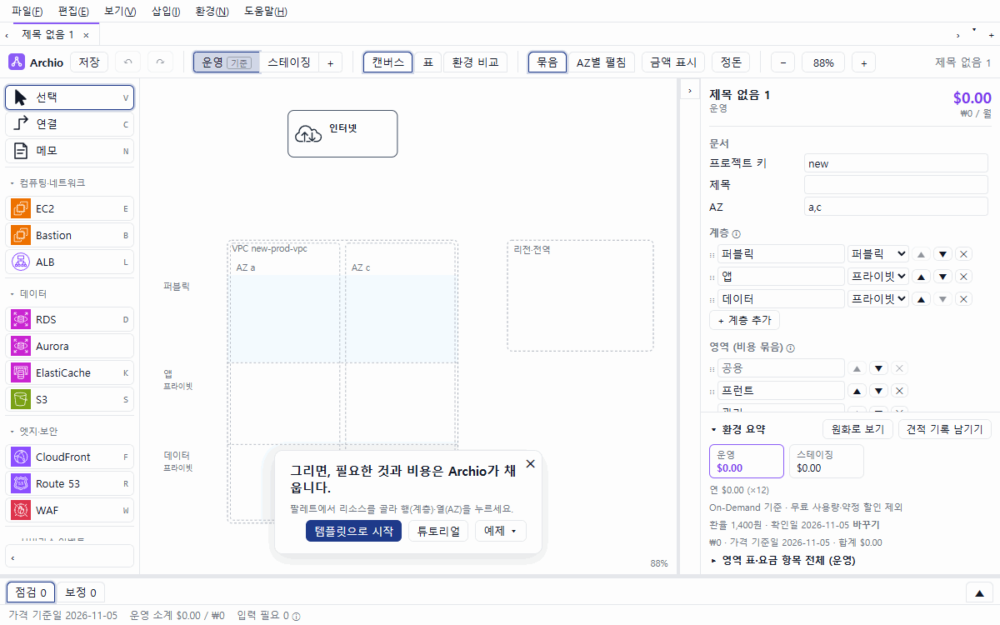
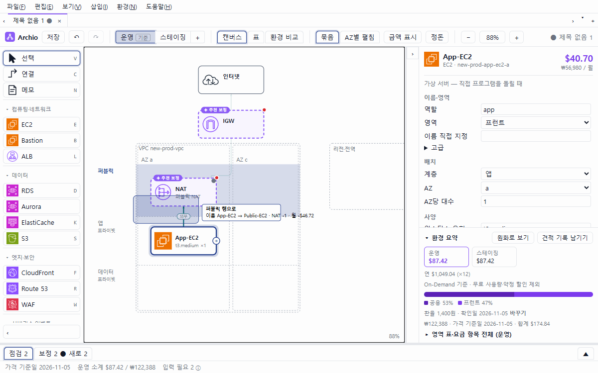
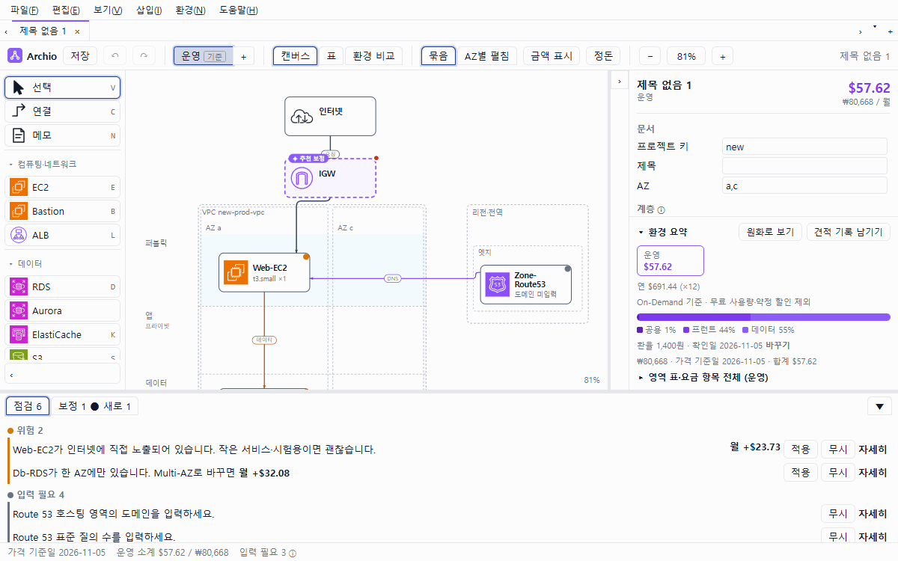
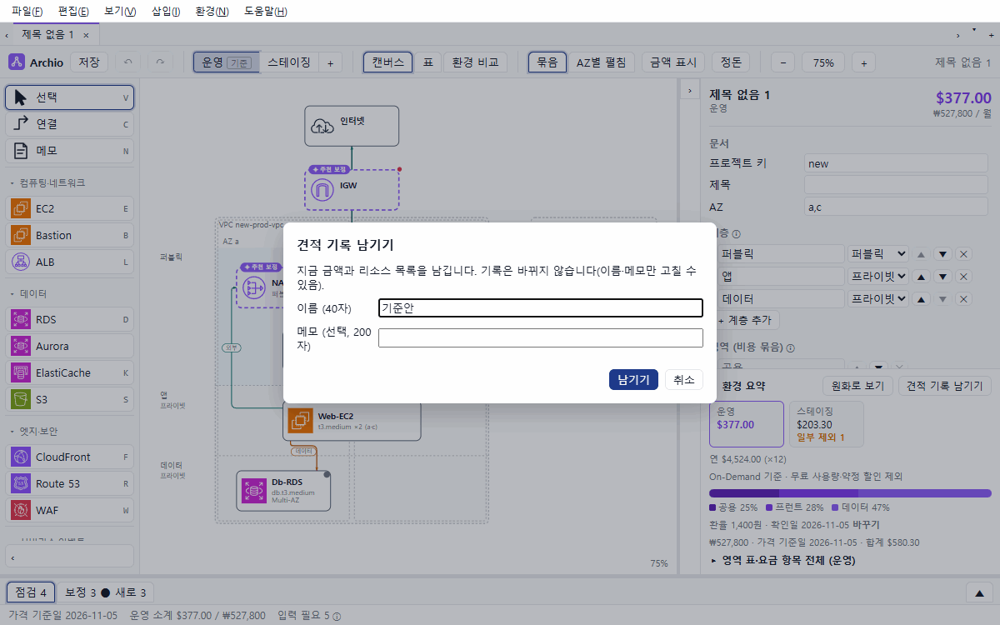
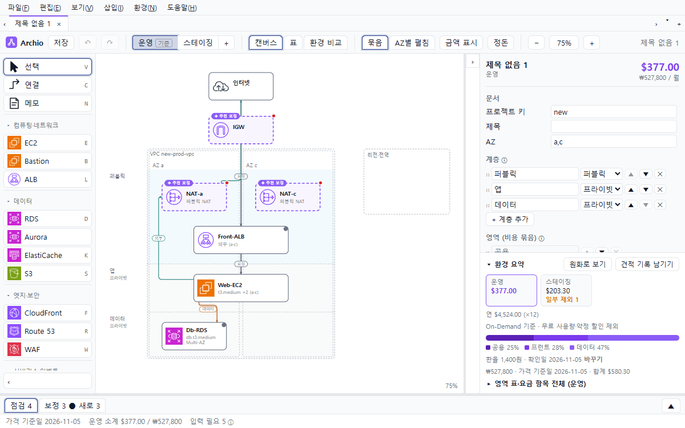
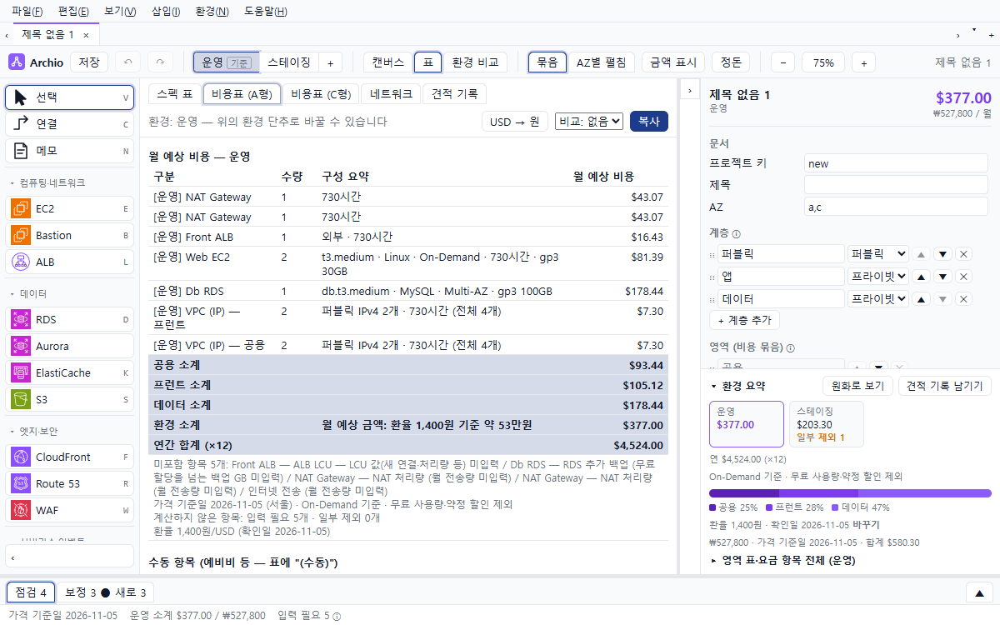
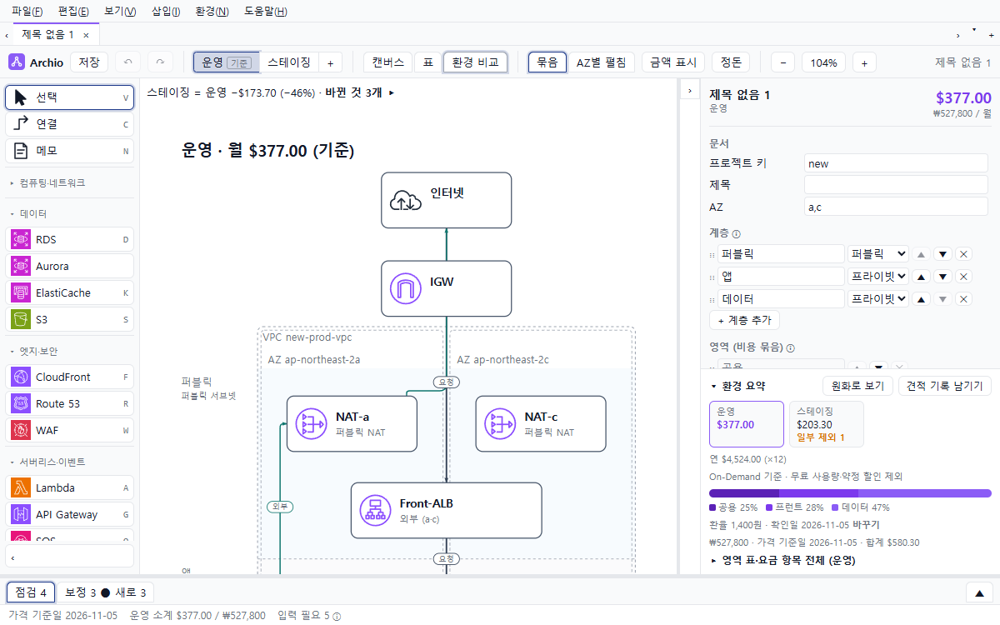
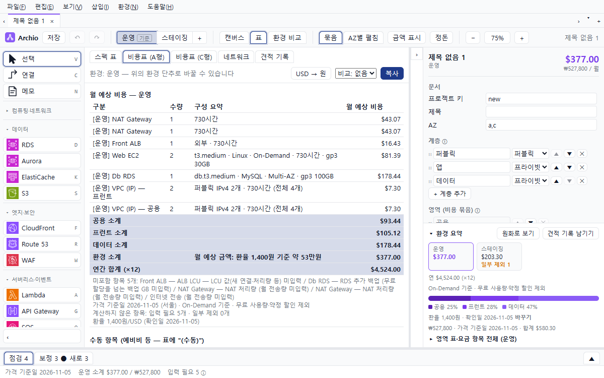
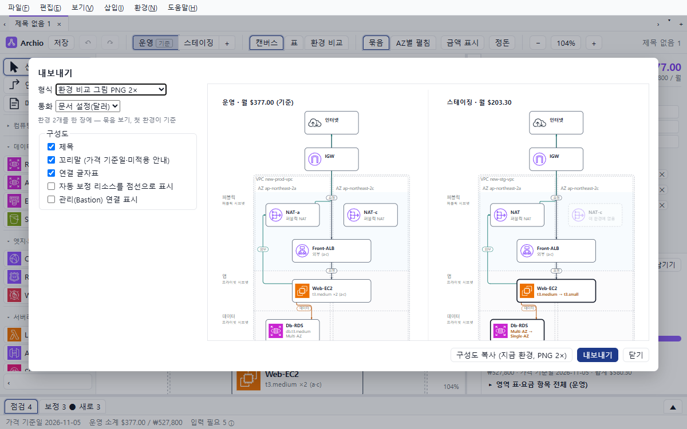
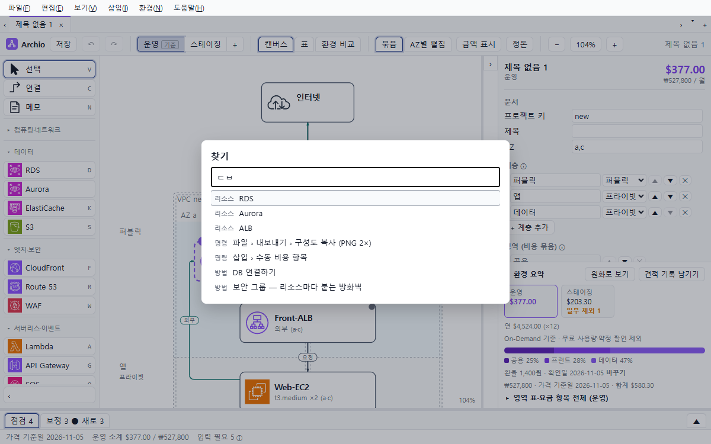

<h1 align="center">Archio</h1>

<i>AWS architecture canvas that fills in what your design needs — auto-corrected resources, naming, and cost estimates</i>

<b>그리면, 나머지는 Archio가 채워요.</b> 
AWS 구성도를 그리는 동안 빠진 리소스와 월 예상 비용, 제안서에 들어갈 표까지 한 번에 만들어 드리는 무료 설계 도구예요.

> 지금은 **1.0 베타(1.0.0-beta.4)**예요. 써 보시고 [문제 알리기](#문제-알리기--아이디어)로 알려 주시면 다음 판에 반영할게요. 버전별 변경은 [CHANGELOG.md](CHANGELOG.md)에 있어요.

## Archio가 특별한 점

### 1. 그리기만 하면 빠진 리소스를 채워요

서버를 놓고 인터넷에 이으면 인터넷 게이트웨이·NAT 게이트웨이·공인 IP·보안 그룹처럼 **동작하려면 꼭 있어야 하는 것**을 Archio가 넣어요. 왜 넣었는지와 월 얼마인지 카드로 보여 드리고, 필요 없으면 바로 뺄 수 있어요.

### 2. 바꾸기 전에 금액이 먼저 보여요

노드를 끄는 동안 "NAT −1 · 월 −$46.72"처럼 **놓기 전에** 무엇이 바뀌고 얼마가 달라지는지 보여요. 인스턴스 목록에는 vCPU·메모리·월 금액이 함께 나와서, 영문 이름을 몰라도 크기를 고를 수 있어요.

### 3. 점검 탭이 위험과 고치는 비용을 알려 줘요

"DB가 한 AZ에만 있어요 — Multi-AZ로 바꾸면 월 +$32.08"처럼 **무엇이 위험하고 고치면 얼마인지** 한 줄로 알려 드려요. [적용] 한 번이면 바뀌고, Ctrl+Z로 되돌릴 수 있어요. 빠진 연결과 입력이 필요한 값도 같은 곳에 모여요.

### 4. 템플릿으로 1분 만에 시작해요

EC2 한 대·웹 3계층·정적 사이트·서버리스 API·컨테이너 중 하나를 고르면 구성과 금액이 바로 채워져요. 운영·스테이징 두 환경도 처음부터 나뉘어 있어요.

### 5. 견적 "안"을 비교하고, 원화 보고서로 내요

견적 기록에 이름을 붙여 "안"으로 남기고, 두 안을 골라 **차액과 바뀐 리소스**를 나란히 봐요. 보고 통화를 원화로 정하면 Excel 모든 시트와 그림 제목이 원화로 나오고, 연간 합계와 예비비 %도 넣을 수 있어요.

## 기본으로 다 돼요

| | 기능 |
|---|---|
| ✅ | **한 모델에서 제안서 자료가 함께** — 구성도(PNG·SVG), AWS 리소스 이름, 상세 스펙 표, 환경별 비용표, 네트워크 표, Excel 통합 파일이 서로 어긋나지 않아요 |
| ✅ | **운영·스테이징·개발 한 문서로** — 다른 것만 덮어쓰고, 환경 비교 그림에 바뀐 곳이 표시돼요 |
| ✅ | **넓은 서비스** — VPC·EC2·ALB·RDS·Aurora·S3·CloudFront·Route 53·WAF·ElastiCache·CloudWatch·Lambda·API Gateway·SQS·SNS·EventBridge·ECS·EKS·Fargate·ECR·CI/CD |
| ✅ | **Terraform 초안** — 환경마다 폴더, `terraform validate` 통과, 접속 수단과 apply 전 확인 목록까지 |
| ✅ | **찾기(Ctrl+K)** — 리소스·명령·방법 안내를 한글 초성으로도 찾아요 |
| ✅ | **리소스 한 줄 설명** — "NAT 게이트웨이: 프라이빗 서버가 업데이트·외부 API를 쓸 때 필요" 같은 설명이 늘 곁에 |
| ✅ | **명령줄** — `validate`·`estimate`·`names`·`export`, 빌드·CI용 종료 코드 |
| ✅ | **안전하게** — 모든 편집 되돌리기, 탭마다 작성 중 보관과 복구, 손상된 파일도 고칠 수 있는 데까지 고쳐서 열기 |
| ✅ | **인터넷 없이·무료** — 서울 리전 가격표가 앱에 들어 있고, 문서나 사용 기록을 밖으로 보내지 않아요 |

## 설치

[Releases](../../releases)에서 최신 판의 `Archio_<버전>_x64-setup.exe`를 받아 실행하세요. Windows 10·11 64비트에서 동작해요.

> 처음 실행할 때 "Windows의 PC 보호" 창이 뜰 수 있어요. 코드 서명을 하지 않은 무료 베타라서 나오는 경고예요. **추가 정보 → 실행**을 누르면 됩니다.
> 설치가 꺼려지면 설치 없이 쓰는 실행판(`Archio_<버전>_x64_portable.zip` — 압축을 풀고 `archio.exe` 실행)을 쓰세요. 받은 파일이 원본 그대로인지는 Releases에 적힌 SHA-256 값으로 확인할 수 있어요.

자세한 안내는 [설치 안내](INSTALL.md)에 있어요.

## 처음 시작하기

1. 시작 안내의 **[템플릿으로 시작]**을 눌러 가까운 구성을 고르세요. 빈 문서에서 그려도 돼요.
2. 왼쪽 팔레트에서 리소스를 고르고 캔버스의 행(계층)과 열(AZ)을 눌러 놓아요.
3. **연결(C)**로 이어요. 이을 수 있는 대상이 강조되고, 보라 점선으로 생기는 것이 Archio가 채운 리소스예요.
4. 아래 **점검** 탭에서 위험과 입력할 값을 확인하고, 오른쪽 패널에서 사양과 월 금액을 다듬어요.
5. **파일 › 내보내기**로 구성도·Excel·Terraform을 만들어요.

## 더 둘러보기

놓기 → 잇기(IGW·NAT 자동) → 끌기 미리보기 → 스테이징 덮어쓰기 → 비용표·스펙 표 → 환경 비교 그림

| | |
|---|---|
|  |  |
| **캔버스** — 계층 × AZ 격자에 놓고 이으면 선은 알아서 정돈돼요 | **비용표** — 서비스별 월 비용, 소계, 연간 합계 |
|  |  |
| **환경 비교** — 맨 위에 차액·%·바뀐 개수 | **네트워크 표** — 서브넷 CIDR이 겹치지 않게 자동으로 |
|  |  |
| **내보내기** — 구성도·환경 비교 그림·Excel·Terraform | **찾기(Ctrl+K)** — "ㄷㅂ"만 쳐도 DB가 나와요 |

## AWS 요금 계산기·그림 도구와 다른 점

| | 요금 계산기 | 그림 도구 | **Archio** |
|---|---|---|---|
| 구성도 | — | 직접 그림 | 그리면 빠진 리소스까지 채움 |
| 월 비용 | 항목을 하나씩 입력 | — | 그림에서 바로, 계산식까지 |
| 스펙 표·네트워크 표·이름 | — | — | 같은 모델에서 자동 |
| 환경별 비교 | 견적을 따로 만듦 | 그림을 따로 그림 | 한 문서에서 덮어쓰기·비교 |
| Terraform | — | — | 환경마다 초안 |

## 자세한 사용법

앱의 **도움말 › 사용 설명서**에 그리기·자동 보정·환경·이름·표·비용·내보내기·단축키가 있어요. 리소스와 용어 설명은 사용 설명서 끝의 **리소스 사전**이나 찾기(Ctrl+K)에서 볼 수 있어요.

## 문제 알리기 · 아이디어

- 쓰다가 막히거나 이상하면 [Issues](../../issues/new/choose)의 **문제 알리기**로 알려 주세요. 버전(도움말 › Archio 정보)과 재현 순서를 적어 주시면 빨리 고칠 수 있어요.
- 문서 파일을 올리실 때는 회사·고객 이름과 실제 도메인을 지운 뒤 올려 주세요.
- "이런 게 있으면 좋겠다"도 환영해요.

## 사용 조건

무료 베타예요. 예상 비용은 AWS 공개 가격표(서울, On-Demand)로 계산한 참고값이고, 무료 사용량·약정 할인·세금은 넣지 않아요. 자세한 내용은 [TERMS.md](TERMS.md)에 있어요. Archio는 Amazon Web Services와 관계가 없으며, AWS와 각 서비스 이름·아이콘은 Amazon.com, Inc. 또는 그 계열사의 상표예요. 앱에 쓴 오픈소스의 고지는 설치 폴더의 `THIRD-PARTY-NOTICES.txt`와 앱의 **도움말 › Archio 정보**에 있어요.

로고는 고리 노드 셋이 이룬 **A**예요. 실선 두 다리는 사용자가 그린 연결, 점선 가로대는 Archio가 채워 넣은 연결 — 그린 것에 빠진 것을 채워야 설계가 완성된다는 뜻이에요. 이름은 Architecture에서 왔어요.
