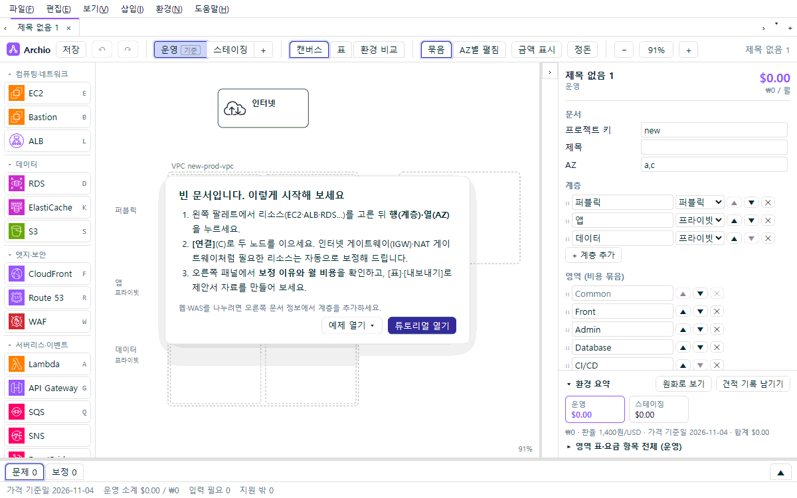

<h1 align="center">Archio</h1>

<b>그리면, 나머지는 Archio가 채웁니다.</b> 
AWS 구성도를 그리는 동안 빠진 리소스와 월 예상 비용, 제안서에 들어갈 표까지 함께 만들어 드리는 설계 도구입니다.

<i>AWS architecture canvas that fills in what your design needs — auto-corrected resources, naming, and cost estimates</i>

> 지금은 1.0 시험판(1.0.0-beta.3)입니다. 써 보시고 불편한 점을 알려 주시면 다음 판에 반영하겠습니다. 버전별 변경은 [CHANGELOG.md](CHANGELOG.md)에 있습니다.

## 이런 분께 권해 드립니다

- 제안서나 설계 문서의 **인프라 장**을 써야 하는데, 구성도·스펙 표·비용표를 따로 만들다 숫자가 어긋난 경험이 있는 분
- AWS 요금 계산기를 여러 번 오가며 **월 예상 비용**을 맞추느라 시간을 쓰시는 분
- 운영·스테이징·개발 환경을 **한 번에 비교**해 고객이나 팀에 보여 드려야 하는 분
- 그린 구성 그대로 **Terraform 초안**까지 받아 보고 싶은 분

## Archio는 이런 걸 해낼 수 있어요

### 클릭 두 번이면 첫 금액이 나옵니다
EC2 하나를 놓는 순간 월 $40.70이 표시됩니다. 금액에 마우스를 올리면 "단가 × 730시간 × 대수"처럼 계산식을 그대로 보여 드려서, 숫자를 믿고 쓰실 수 있습니다.

### 빠뜨리기 쉬운 리소스를 먼저 챙겨 드립니다
프라이빗 서버를 인터넷에 이으면 인터넷 게이트웨이·NAT 게이트웨이·퍼블릭 IP·보안 그룹처럼 **동작하려면 꼭 있어야 하는 것**을 자동으로 넣어 드립니다. 무엇을 왜 넣었는지, 그래서 얼마가 더 드는지 카드로 알려 드리고, 필요 없으면 바로 뺄 수 있습니다.

### 바꾸기 전에 결과를 미리 보여 드립니다
노드를 끄는 동안 "NAT −1 · 월 −$46.72"처럼 무엇이 빠지고 금액이 얼마나 달라지는지 **놓기 전에** 보여 드립니다. 지울 때도 함께 사라지는 리소스와 금액 변화를 먼저 확인하실 수 있습니다.

### 운영·스테이징을 한 문서에서 비교합니다
스테이징에서 사양만 낮추면 그 환경에만 적용됩니다. 환경 비교 그림에는 "t3.medium → t3.small"처럼 달라진 곳이 표시되어, 고객 보고 자료로 바로 쓰실 수 있습니다.

### 제안서 자료가 한 번에, 서로 어긋나지 않게 나옵니다
구성도(PNG·SVG), AWS 리소스 이름(네이밍), 상세 스펙 표, 환경별 비용표, 네트워크 표, Excel 통합 파일이 **모두 하나의 설계에서** 만들어집니다. 한 곳을 고치면 모든 자료가 함께 바뀝니다.

### 바로 검토할 수 있는 Terraform을 드립니다
파일 › 내보내기 › Terraform 폴더를 고르시면 환경마다 폴더를 나눠 `terraform validate`를 통과하는 코드를 만들어 드립니다(지금은 VPC·EC2·ALB·RDS·S3·CloudFront·Route 53 등 기본 구성까지 — 서버리스·컨테이너는 다음 판부터). 저장 암호화, S3 공개 차단, 보안 그룹 간 참조 같은 안전한 기본값이 들어 있고, 한국어 README가 함께 들어 있습니다.

### 다루는 서비스
| 분류 | 서비스 |
|---|---|
| 컴퓨팅·네트워크 | VPC, EC2, Bastion, ALB, NAT 게이트웨이, 인터넷 게이트웨이 |
| 데이터 | RDS(MySQL·PostgreSQL), ElastiCache, S3 |
| 엣지·보안 | CloudFront, Route 53, WAF, ACM |
| 서버리스·이벤트 | Lambda, API Gateway, SQS, SNS, EventBridge |
| 컨테이너 | ECS, EKS, Fargate, ECR |
| 운영 | CloudWatch, CI/CD |

## 믿고 쓰실 수 있도록

- **인터넷 없이 동작합니다.** 서울 리전 가격표가 앱 안에 들어 있고, 문서나 사용 기록을 밖으로 보내지 않습니다.
- **가정은 숨기지 않습니다.** 모든 표와 그림 아래에 가격 기준일, 환율, "On-Demand 기준·무료 사용량과 할인 미적용"을 함께 적습니다.
- **모르는 값은 0으로 채우지 않습니다.** 데이터 전송량처럼 입력이 필요한 항목은 "입력 필요"로 따로 알려 드려, 실제보다 싸 보이지 않게 합니다.
- **환율은 문서마다 정하실 수 있습니다.** 기본은 1,400원/USD이며, 문서 정보에서 바꾸면 모든 원화 금액이 함께 바뀝니다.
- **되돌리기가 정확합니다.** Ctrl+Z 한 번이면 보정된 리소스까지 원래대로 돌아갑니다.

## 설치 (Windows)

1. 설치 파일 `Archio_<버전>_x64-setup.exe`를 받아 실행합니다. 설치가 막힌 PC라면 `Archio_<버전>_x64_portable.zip`을 풀어 `archio.exe`를 바로 실행하세요.
2. 아직 코드 서명이 없어 "Windows의 PC 보호" 창이 뜰 수 있습니다. 함께 안내해 드린 SHA-256 값(받은 파일이 원본과 같은지 확인하는 지문)을 확인하신 뒤 **추가 정보 → 실행**을 눌러 주세요.

자세한 안내는 [설치 안내](INSTALL.md)에 있습니다. 배포 파일은 [Releases](../../releases)에 있습니다.

## 5분 만에 시작하기

1. 빈 문서의 안내 카드에서 **튜토리얼 열기**나 **예제 열기**를 눌러 완성된 문서를 먼저 둘러보세요.
2. 왼쪽 팔레트에서 EC2(E)·ALB(L)·RDS(D)를 고르고, 캔버스의 행(계층)과 열(AZ)을 눌러 놓습니다.
3. 연결(C)로 이어 주세요. 보라색 점선으로 표시된 것이 Archio가 채운 리소스입니다.
4. 오른쪽 패널에서 사양과 월 금액을, 위쪽 **표** 보기에서 스펙 표·비용표·네트워크 표를 확인합니다.
5. 파일 › 내보내기로 구성도·Excel·Terraform을 만드시면 됩니다.

더 자세한 사용법은 앱의 **도움말 › 사용 설명서**에서 보실 수 있습니다.

## 로고와 이름

로고는 고리 노드 셋이 이룬 **A**입니다. 실선 두 다리는 사용자가 그린 연결이고, 점선 가로대는 Archio가 채워 넣은 연결입니다. A가 가로대가 있어야 글자가 되듯, 그린 것에 빠진 것을 채워야 설계가 완성된다는 뜻을 담았습니다. 이름은 Architecture에서 왔습니다.
